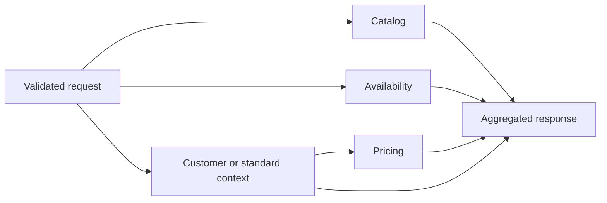

# Product Service

Backend engineering assignment: a market-aware product information aggregator.

## Current scope

The REST API aggregates four in-process simulated upstream services, with parallel
calls, independent timeouts, a shared request budget and partial-failure fallback.
No database or external services are required. Contract, aggregation and mock tests
cover successful responses, failures, timeouts, localization and cancellation.

The required REST behavior is implemented: market-aware product data, optional customer
context, realistic simulated upstream failures and partial responses. gRPC is an optional
bonus and is not implemented. The design question answered below is Option A.

## Requirements

- JDK 21
- Maven is provided by the included Maven Wrapper (3.9.12).
- Internet access is required for the first dependency download.

## Build and run

On Windows, select your JDK 21 installation for the current PowerShell session.
Replace the example path; skip the environment assignments if Java 21 is already selected:

```powershell
$env:JAVA_HOME = 'C:\path\to\jdk-21'
$env:PATH = "$env:JAVA_HOME\bin;$env:PATH"
java -version
./mvnw.cmd clean verify
./mvnw.cmd spring-boot:run
```

On Linux/macOS, set `JAVA_HOME` to a JDK 21 installation and run:

```shell
sh mvnw clean verify
sh mvnw spring-boot:run
```

Health endpoint: `http://localhost:8080/actuator/health`.

Alternatively, after building:

```shell
java -jar target/productservice-0.0.1-SNAPSHOT.jar
```

The default port is 8080; override it with `--server.port=8081` when running the JAR.
Mocks can fail randomly by default, as required by the assignment. See the scenario
section for configuration that disables random errors or forces a specific failure.

With the application running, request a Polish product for a VIP customer:

```powershell
Invoke-RestMethod 'http://localhost:8080/api/v1/products/P-123?market=pl-PL&customerId=C-1' | ConvertTo-Json -Depth 10
```

Or use curl:

```shell
curl -i 'http://localhost:8080/api/v1/products/P-123?market=pl-PL&customerId=C-1'
```

On successful customer and pricing calls, the VIP price is 100 PLN before discount,
10 PLN discount and 90 PLN final price. Omit `customerId` for standard pricing.
Use `P-456` to see known zero stock, or an unknown product ID to exercise Catalog's 404.

## Structure

```text
src/main/java/com/kramp/productservice/
  ProductServiceApplication.java
  api/              REST controller, response DTOs and Problem Details
  application/      Aggregation, deadlines, cancellation and fallback
  domain/           Product, pricing, stock, market and customer models
  upstream/         Client interfaces and typed failures
    mock/           In-process mocks and simulation settings
src/main/resources/application.yaml
src/test/java/com/kramp/productservice/
  api/              REST contract and response invariants
  application/      Aggregation, concurrency and timeout tests
  upstream/mock/    Mock data and simulation tests
```

`ProductController` validates inputs and delegates through `ProductQuery` to
`ProductAggregator`. `UpstreamCalls` owns each request's asynchronous calls and
cancellation. `AggregationProperties` defines time budgets; `MockProperties` and
`MockSimulation` define upstream behavior. `ApiExceptionHandler` maps failures
to HTTP Problem Details.

The application layer returns domain data; the API layer maps it to the public response.

## API contract

`GET /api/v1/products/{productId}?market=pl-PL&customerId=customer-123`

### Inputs

- `productId`: 1-100 ASCII letters, digits, dots, underscores or hyphens; starts with a letter or digit.
- `market`: required, exactly `nl-NL`, `de-DE` or `pl-PL` (case-sensitive).
- `customerId`: optional; when supplied, follows the same rules as `productId`. Empty values are invalid.

Market defines the language and currency: Dutch/EUR, German/EUR, Polish/PLN.
IDs are opaque strings. These validation rules are a project choice, not specified by the assignment.

### Response

Example of a partial response when pricing and stock are unavailable:

```json
{
  "market": "pl-PL",
  "product": {
    "id": "P-123",
    "name": "Filtr oleju",
    "description": "Część zamienna do maszyn rolniczych",
    "specifications": {"sku": "P-123"},
    "images": []
  },
  "pricing": {"status": "UNAVAILABLE", "data": null},
  "availability": {"status": "UNKNOWN", "data": null},
  "personalization": "STANDARD"
}
```

Available pricing has `status: AVAILABLE` and `data` containing `basePrice`,
`discountAmount`, `finalPrice` and an ISO currency code. Amounts are decimals;
`discountAmount` is an amount, not a percentage. Pricing owns calculation and rounding.
Available stock has `status: AVAILABLE` and `data` containing nonnegative `stockLevel`,
`warehouseLocation` and nullable `expectedDeliveryDate` (`YYYY-MM-DD`).
A stock level of zero means out of stock; `UNKNOWN` means no stock data is available.
Personalization is `STANDARD` or `PERSONALIZED`; customer IDs and preferences are not exposed.

Catalog is required. Pricing and availability failures produce a partial `200` response.
Customer failure uses `CustomerContext.standard()` for pricing and returns `STANDARD`.
Personalization reflects the resolved customer context, even when pricing is unavailable.

### Errors

All errors use `application/problem+json` (RFC 9457), with `title`, `status`,
`detail` and `instance`. Custom errors also include `type` using
`urn:productservice:problem:<code>`; framework errors may omit it (implicitly `about:blank`).

| HTTP status | Meaning |
| --- | --- |
| 400 | Missing/invalid input or unsupported market |
| 404 | Catalog confirms the product does not exist |
| 503 | Required upstream data is unavailable |
| 504 | Required upstream data timed out |
| 500 | Unexpected server error; internal details are not returned |

```json
{
  "type": "urn:productservice:problem:unsupported-market",
  "title": "Bad Request",
  "status": 400,
  "detail": "Unsupported market. Supported values: nl-NL, de-DE, pl-PL.",
  "instance": "/api/v1/products/P-123"
}
```

### Upstream contracts

Clients are blocking interfaces, independent of Spring and REST DTOs. They return
non-null domain data or throw typed exceptions. Concurrency and fallback belong to
the aggregator; a timeout exception also represents an aggregator deadline.
Only Catalog may report `ProductNotFoundException`. Failures from optional sources
must be caught by the aggregator before they reach the REST exception handler.
Pricing receives the resolved customer context rather than looking up the customer again.
The customer client is called only when a customer ID is provided.

### Tests

Run `./mvnw.cmd verify` (Windows) or `sh mvnw verify` (Linux/macOS).
The current suite contains 33 tests. Maven prints the results and stores reports
under `target/surefire-reports/`.
Contract tests verify all markets, request forwarding, input validation, partial JSON,
zero stock, currency serialization, error status mappings and hidden internal details.
Aggregation tests separately verify parallel calls, source deadlines, shared budget,
customer fallback and worker interruption. Mock tests use fixed clocks and deterministic
reliability settings. No Mockito Java agent is needed.

## Aggregation and mock scenarios

Catalog, Availability and Customer start concurrently. Customer is skipped when no
customer ID is supplied. Pricing starts after Customer returns or falls back to standard
context. This dependency is a design choice: the assignment does not specify how Pricing
obtains customer context. Passing it explicitly prevents a failed lookup from retaining
a personalized discount.



| Source failure | Result |
| --- | --- |
| Catalog error / timeout | 503 / 504; remaining calls are cancelled |
| Catalog product missing | 404; remaining calls are cancelled |
| Pricing error / timeout | 200, `pricing.status = UNAVAILABLE`, null price data |
| Availability error / timeout | 200, `availability.status = UNKNOWN`, null stock data |
| Customer error / timeout | Standard context is passed to Pricing; no personalized discount |

| Source | Typical latency | Reliability | Timeout |
| --- | --- | --- | --- |
| Catalog | 50 ms | 99.9% | 150 ms |
| Pricing | 80 ms | 99.5% | 180 ms |
| Availability | 100 ms | 98% | 200 ms |
| Customer | 60 ms | 99% | 120 ms |

The overall aggregation budget is 400 ms. Each source gets the smaller of its own
timeout and the remaining request budget, including dependent Pricing. Monotonic time
is used. This bounds upstream waiting, not servlet queueing, serialization or network
delivery. Nominal critical paths are 100 ms without a customer and 140 ms with one,
before scheduling overhead; timeout values are initial choices, not production SLOs.

Blocking calls use a shared Java 21 virtual-thread executor and scheduled deadlines.
A timeout completes the result and interrupts its worker. Catalog is awaited first;
its failure cancels optional work. Request scopes cancel unfinished work on every exit.
Real HTTP adapters must also configure connect/read deadlines and transport cancellation:
interruption alone cannot guarantee arbitrary code or remote work terminates.
There are no retries, which could consume the budget and amplify outages.

Demo products: `P-123` is an oil filter with 42 units; `P-456` is a belt with zero stock
and no delivery date. Other product IDs return 404 unless Catalog simulation fails first.
VIP customers `C-1` and `customer-123` receive a 10% discount. Other customers use the
standard context. Product names/descriptions and warehouses vary by market; images are
empty because the demo has no image assets. Prices for `P-123`: 100 PLN, 24 EUR in Germany,
25 EUR in the Netherlands. `P-456` costs twice as much. Discounts use `BigDecimal` with
two decimals and `HALF_UP` rounding. In-stock delivery uses an injectable UTC clock plus
two days. These are simulated amounts, not a currency conversion.

Configuration under each `mock.<source>` supports `latency`, `jitter` (default 10 ms),
`reliability`, `mode` and `slow-latency` (default 2 seconds). NORMAL uses uniform delay
variation and independent random failures sampled after the delay. Reliability is a
long-run probability, not an exact ratio per test run. FAIL forces an error after the
normal delay; SLOW forces the slow delay and ignores random failure for repeatable tests.

To disable random errors, launch the packaged JAR with:

```shell
java -jar target/productservice-0.0.1-SNAPSHOT.jar --mock.catalog.reliability=1 --mock.pricing.reliability=1 --mock.availability.reliability=1 --mock.customer.reliability=1
```

Latency variation and deadlines still apply: reliability 1 does not disable timeouts.

Append one of these overrides to that command:

```text
--mock.pricing.mode=FAIL          # 200, price unavailable
--mock.availability.mode=SLOW    # 200, stock unknown
--mock.customer.mode=FAIL        # 200, standard price without discount
--mock.customer.mode=SLOW        # customer timeout, then standard price
--mock.catalog.mode=FAIL         # 503
--mock.catalog.mode=SLOW         # 504
```

Scenario comments describe requests for an existing demo product. Supply `customerId=C-1`
when testing Customer failures, since anonymous requests skip that source. Stop the
previous process before restarting with a different scenario, or select another port.

Budgets are configured under `aggregation`: `request-timeout`, `catalog-timeout`,
`pricing-timeout`, `availability-timeout`, `customer-timeout`. Invalid durations and
reliability values fail application startup.

## Design decisions

- Java 21 and Spring Boot 4.1.1 with Maven.
- Spring MVC for REST, Bean Validation for input validation, Actuator for health.
- No database is needed for the simulated upstream services.
- Aggregation logic is separated from upstream implementations.

### Why the mocks run inside the application

The assignment asks for simulated upstream implementations with latency and failures;
it does not require separate processes or HTTP connections. In-process adapters keep
local setup small and focus the solution on aggregation, required versus optional data,
deadlines and fallback within the suggested 3-4 hour scope.

The trade-off is that these tests do not simulate network connections, HTTP status
decoding or transport cancellation. To cover those, replace the client adapters with
HTTP implementations and run a separate mock server with four endpoints. The aggregation
and domain layers can remain the same. A database, Docker Compose and separate mock
applications are not needed to run the current solution.

## Design question: related products (Option A)

Related products would be an optional upstream source with an independent timeout.
Its 200 ms typical latency and 90% reliability must not make the core product
unavailable. The source would run concurrently where dependencies allow, using
only the remaining request budget. Failure would return an explicit unavailable
state for recommendations. A client interface and adapter would isolate the new
source from the existing upstream implementations.

## Further work

Before production, add per-source latency/error/timeout metrics, request IDs and tracing;
upstream concurrency limits, transport deadlines, load tests and customer access checks.
Virtual threads simplify blocking I/O but do not provide backpressure. Evaluate circuit
breakers and graceful draining. Cache keys must include market/customer context, with
different freshness policies for catalog, prices and stock. No caching is implemented.
Health does not call the randomly failing mocks; optional failures log source and failure
type without customer IDs.
